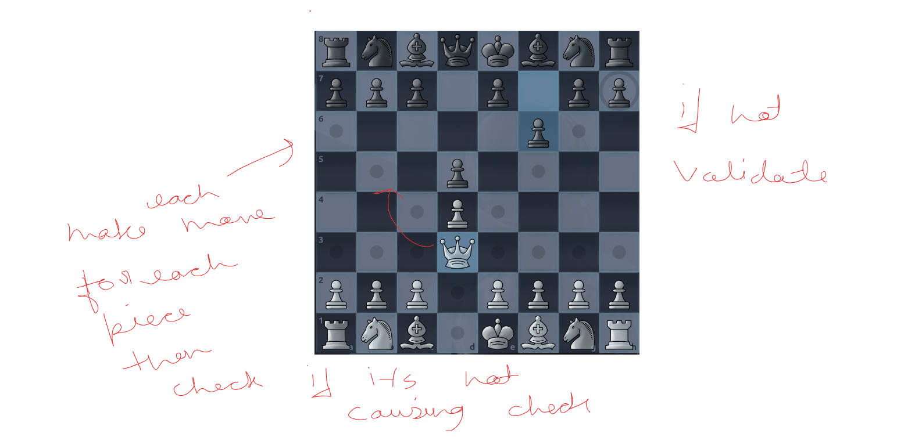
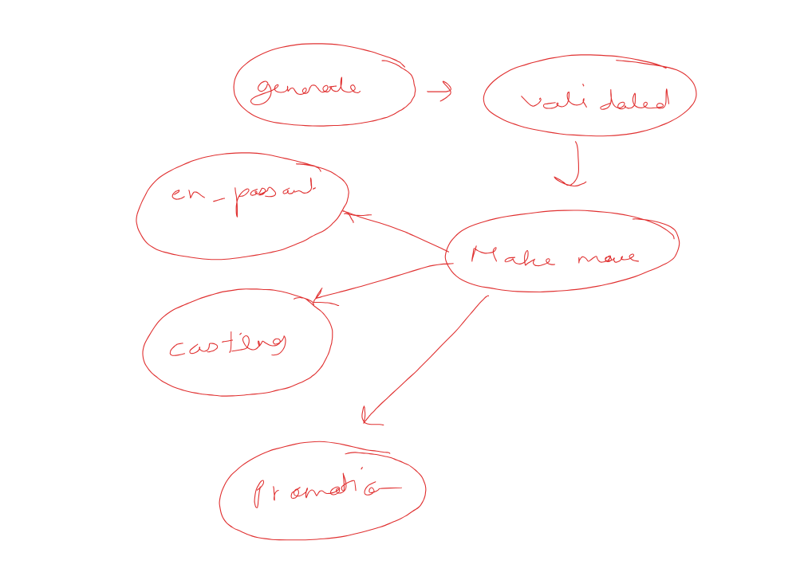

Chess Engine: Legal Moves and Making a Move

Generating Legal Moves
Step 1: Check the piece
• Make sure the piece number passed has exactly one piece on it.
• Make sure that piece belongs to the side that is about to move.
Step 2: If the piece is a king
• Get all the normal moves the king can make.
• Get the castling moves too.
• Return all of them.
Step 3: If the piece is not a king
• Generate all the possible moves for the piece.
• Go through each move one by one.
• Make the move on the board and check if it is legal (for example, the king is not left in check).
• If the move is legal, add it to the list.
• Return the list of legal moves.
Flow
• First, the engine generates the legal moves.
• Then, the user makes a move from that list.
• 
Making the Move
Step 1: Get the enemy side
• Find out which side is the opponent.
Step 2: Set up the conditions
• Check if the moving piece is a pawn.
• Check if the moving piece is a king.
• Check if this move is an en passant capture.
    ◦ The piece must be a pawn.
    ◦ The en passant target must be available.
    ◦ The "to" square must be equal to that target.
Step 3: Find the captured piece
• If it is an en passant capture:
    ◦ Get the square of the pawn that will be captured.
    ◦ Get that pawn as the victim.
• In every other case:
    ◦ The victim is the piece sitting on the "to" square, the one that is in the way of the moving piece.
• Remove the victim from the enemy side's bitboard.
Step 4: Handle castling
• Check if the player is trying to castle.
    ◦ This is true when the king moves 2 squares sideways.
• Find out which type of castling it is (king side or queen side).
• Based on the type, get the rook's starting square and its new square.
• Move the rook to its new square.
Step 5: Handle promotion
• The pawn has already been moved at this point.
• Take that piece and check if it should be promoted.
    ◦ This is true when the pawn has reached the last rank.
• If yes, replace the pawn with the promoted piece (for example, a queen).